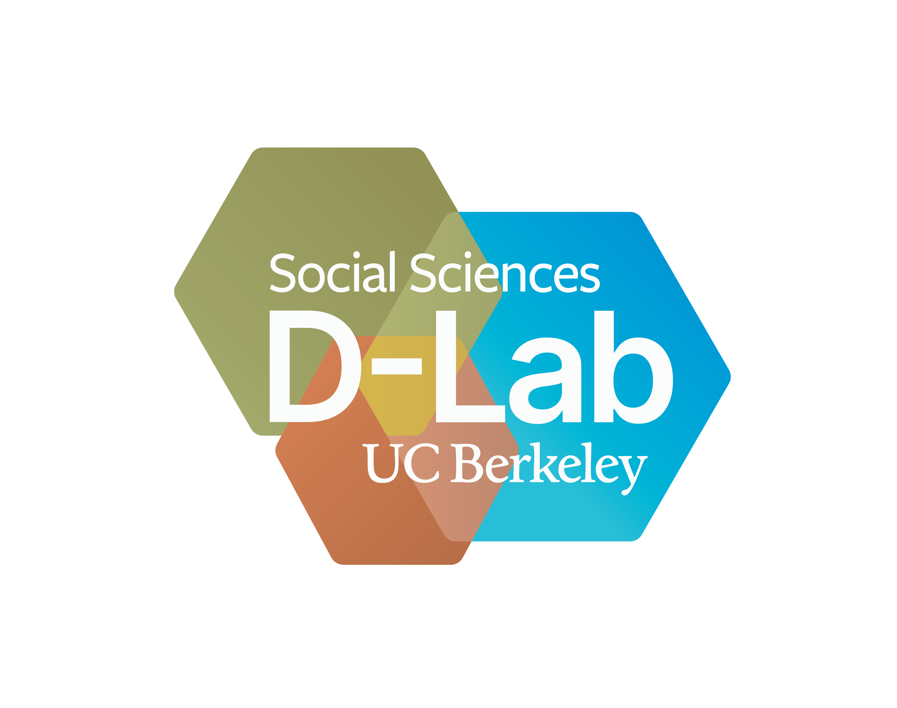

# Qualitative Coding with AI Tools

UC Berkeley D-Lab

Note:
Welcome. "Coding" here means qualitative coding: labeling passages of text with a codebook. There is no programming in this workshop. The question we'll work on is how to check what an AI tool does when it codes interview material for us.

---

## Today's Question

- What does it mean to use AI tools for qualitative methods?
- This is an active field of research.
- In this workshop, we treat AI as a tool for *scalable deductive coding.*

---

## The Bracero Program

- The Bracero Program brought Mexican workers to U.S. farms from 1942–1964.

- The U.S. and Mexican governments agreed to bring Mexican men to work in the United States on short-term contracts, mostly in agriculture.

- About 4.6 million contracts were signed over 22 years.

- The contracts promised wages, housing, and food. In practice, workers often did not get what they were promised.

---

## Today's Dataset: Bracero Oral History Project

- We use excerpts from oral history interviews held by the Institute of Oral History at the University of Texas at El Paso.

- The narrators are braceros' children, growers and their families, local residents, and people who worked alongside the program.

- When a passage describes how the workers felt, someone else is describing it.

- The dataset does not contain interviews with the braceros themselves.

---

## What is a Code?

A code is a label you attach to a passage, and a claim about what the passage is doing.

`T1-WAGE` on a passage claims that it tells us something about pay.

For example, this span provides evidence for that code:

> "the paycheck was probably $2.00"

---

## Two Kinds of Codes in our Codebook

- **Tier 1** codes record what the passage states: a crop, a place, a wage, a contract term, a procedure.

- **Tier 2** codes interpret how the experience is framed: ambivalence, dignity, negotiating power, judgment in hindsight, and hardship.

Tier 2 codes take more judgment, so expect more disagreement on them.

---

## Evidence Spans for Codes

When we code, we will always provide evidence spans from the text.

We will also ask AI tools to provide evidence from the text.

---

## Disagreement Reveals Issues with AI Models, Codes, and Experiments

You might find yourself disagreeing with the codes produced by AI models. This could be because:

- We need to use a more capable model;
- We need to use proper settings (like reasoning effort);
- We need a better prompt;
- We need a more precise code definition;
- AI is not suitable for this task.

---

## Today: code by hand, code with AI, audit, repair

1. **Human coding:** code six passages by hand, then compare with a partner.
2. **AI coding:** run the same prompt through an AI agent twice and compare the results.
3. **Audit:** check a set of AI coding results against the source passages.
4. **Repair:** rewrite one loosely defined code, `T2-HARDSHIP`.

---

## Next: Human Coding

Open `1_Human_Coding.md` and `codebook.md`, both located in the `lessons/` folder.
